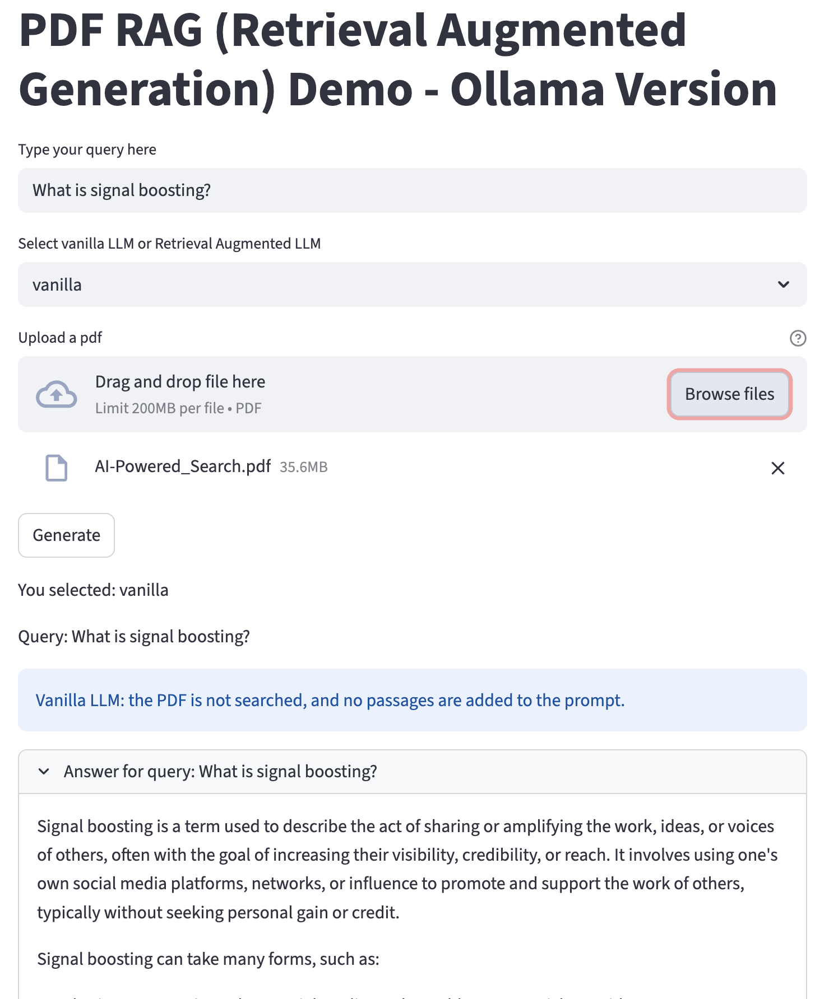
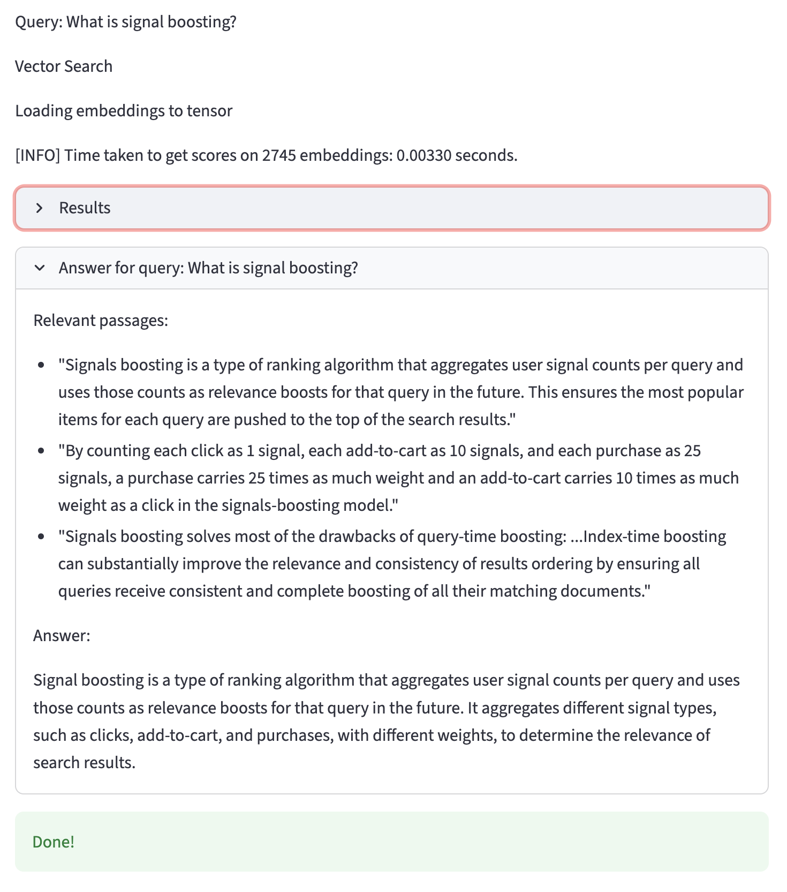

# Week 5

## Lecture overview

The lecture introduces retrieval-augmented generation: embeddings, chunking,
vector and hybrid retrieval, reranking, context assembly and methods for
evaluating both retrieval and generated answers.

## Lab 5 assignment

Build a RAG system for a suitable project task:

1. Prepare a small document collection and a reproducible indexing pipeline.
2. Retrieve and rerank evidence for each query.
3. Add the selected evidence to the model prompt.
4. Compare the system with a no-retrieval baseline using the Week 3
   evaluation protocol.
5. Inspect retrieval failures separately from generation failures.

Keep the indexing configuration, retrieval results, prompts, evaluation
outputs and analysis for the RAG section of the final report. Detailed
materials will be added before this week.

## Sample runs

Both screenshots use the query "What is signal boosting?" on the same PDF.

Vanilla baseline. The model answers from the question alone, and the PDF is not searched.

RAG. Retrieved passages are added to the prompt, and the answer follows those passages.

